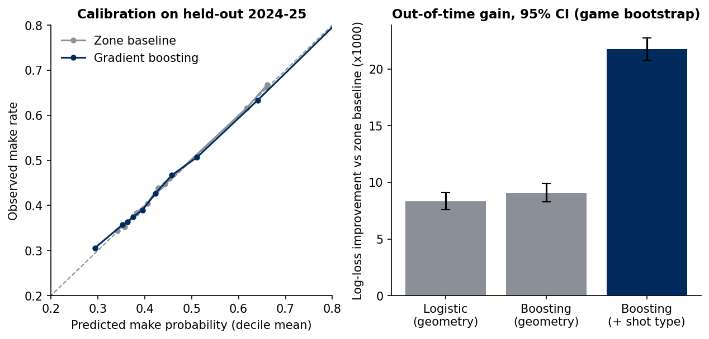
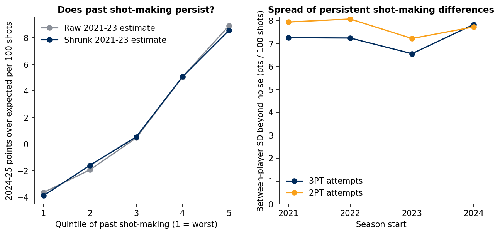

# Shot Quality & Shot-Making: an expected-points model, validated out-of-time, applied to the Utah Jazz

A small, end-to-end analytics project built on ~870,000 NBA field-goal attempts (2021-22 to 2024-25). It answers
three questions a basketball-operations group asks every week:

1. **How good was the shot?** An expected-points-per-shot model, trained on past seasons and tested on a season it never saw.
2. **Who actually makes shots better than the shot deserved, and how much of that is noise?** Empirical-Bayes shrinkage
   with credible intervals, checked by whether it forecasts *next* season.
3. **What does that say about the Jazz?** A one-page, coach-facing brief: [`reports/jazz_brief.md`](reports/jazz_brief.md).

Everything is reproducible from raw CSVs with `make all` (about 3 minutes on a laptop).

## Headline results

| | Result |
|---|---|
| Out-of-time log loss, 2024-25 (lower is better) | zone baseline **0.6575** → logistic 0.6492 → boosting (geometry) 0.6484 → boosting (+ shot type) **0.6357** |
| Gain over baseline, 95% CI (resampling whole games) | geometry-only **0.009** (0.008-0.010); with shot type **0.022** (0.021-0.023) |
| Calibration on held-out season | expected calibration error 0.005; mean predicted FG% 46.6% vs actual 46.7% |
| Does shot-making persist? | Past (2021-23) estimates vs 2024-25 results across 247 players: correlation **0.65**; the persistent between-player spread is about **6.5-7.3 points per 100 shots** |
| Does shrinkage help? | Cuts forecast error 8% vs raw estimates (all shots; 95% CI on the gain excludes zero); 13% for 3PT attempts |
| Do team results carry over year to year? | shot quality allowed r = 0.80, shot quality taken 0.59, shot-making 0.51, shot-making allowed 0.41 (30 teams x 3 season pairs) |

**Jazz 2024-25 in one paragraph.** Their shot diet was among the league's least valuable (27th of 30 in expected
points per shot, because of a low rim rate: 23% of attempts vs 28% league) and their shooting matched expectation
overall. The notable item is on the other end: opponents shot **+4.6 points per 100 shots above expectation**
(29th of 30; league team-level SD 2.5), concentrated at the rim, in the non-restricted paint and from mid-range. That metric
has a year-to-year correlation of 0.41, so part of it is likely real defensive signal not visible in this data
(contest quality, rim deterrence) and part is noise. See the brief for caveats and what I would look at next.




## Method

**Data.** Shot-chart detail (court coordinates, zone, shot-type label, clock, result) from the public
[`shufinskiy/nba_data`](https://github.com/shufinskiy/nba_data) mirror of stats.nba.com, loaded into DuckDB and persisted to Parquet.
`data.validate` hard-fails on duplicate events, non-binary results, coordinate/distance disagreement, and shot-type contradictions.

**Models** (`src/shotquality/model.py`). None sees player or team identity, so *actual minus expected* isolates shot-making from shot selection.
- *Zone baseline*: league make rate by zone/area/range (the bar to beat).
- *Logistic*: spline of distance and angle plus zone indicators.
- *Gradient boosting (geometry)*: coordinates, distance, angle, clock, period, zone.
- *Gradient boosting (+ shot type)*: adds the tracked shot-type label (e.g. "Driving Floating Jump Shot").

**Validation design.** Hyper-parameters are tuned on 2023-24 (trained on 2021-23), the final models are refit on 2021-23 (train + validation) and scored once on
2024-25. Uncertainty comes from a **game-level cluster bootstrap**, since shots within a game are not independent.
For the player study, 2021-23 expectations are *cross-fitted* (each season scored by a model trained on the other training seasons)
and no 2024-25 data touches any predictor.

**Shot-making estimates** (`src/shotquality/shrinkage.py`). Each player's mean points-over-expected is treated as a noisy measurement of a
latent effect, `observed ~ N(true, se²)`, `true ~ N(mu, tau²)`, with the per-shot variance taken from the model's own probabilities and
`tau²` fitted by the DerSimonian-Laird estimator. A simulation test confirms the 90% intervals cover about 90%.

**SQL layer** (`sql/`). Team offence/defence and zone-profile aggregates are plain DuckDB SQL, unit-tested against a hand-computed example.

**Engineering.** Config in one module, fixed seeds, saved model artifacts with metadata (`models/`), a scoring CLI
(`scripts/score_shots.py`) that validates input before scoring, 26 pytest tests, and a Makefile.

## Limitations (read these before quoting any number)

- **No tracking data.** There is no defender distance, shot clock, shooter movement or passer. The AUC (0.66) reflects that; teams with tracking data will beat this model.
  "Shot-making" here is *everything not in the features*, including unmeasured shot difficulty, so the persistent 6.5-7.3 pts/100 spread
  is "persistent player effect", not pure shooting talent.
- **The shot-type label is partly descriptive.** It buys most of the accuracy gain (0.022 vs 0.009) but is entered by a scorer and encodes some information about the play
  (dunks and alley-oops are nearly always made). Player ratings from the two models agree reasonably (rank correlation 0.85 among Jazz players)
  but not perfectly; rim finishers such as centres move the most. I report both and would default to the geometry-only model for anything player-evaluative.
- **Small samples.** Even 600 shots leaves a 90% interval roughly 14 points per 100 shots wide, which is why most Jazz players' intervals include zero.
- **Season scope.** The public dataset ends with 2024-25 and the Jazz roster has since changed; this is a method demonstration, not a current scouting report.
- **Defence attribution.** Opponent shot-making is partly team, partly opponent mix and partly luck; I did not adjust for opponent quality.

## Repo layout

```
src/shotquality/   data.py (ingest + validation) · features.py · model.py · shrinkage.py · config.py
sql/               team_shot_quality.sql · zone_profile.sql
scripts/           download_data.py · run_pipeline.py · score_shots.py
tests/             26 tests (features, validation, metrics, shrinkage incl. simulation, SQL)
reports/           jazz_brief.md · results.json · CSV tables · figures/
```

```bash
pip install -r requirements.txt
make all            # download data, run tests, rebuild every table and figure
```

## Next steps I would take with real data

Add tracking features (closest-defender distance, touch time, dribbles) and a player-and-defender random-effects model; move from FG outcomes to
possession-level expected points including free throws and offensive rebounds; track calibration drift by month in a lightweight monitoring job.
